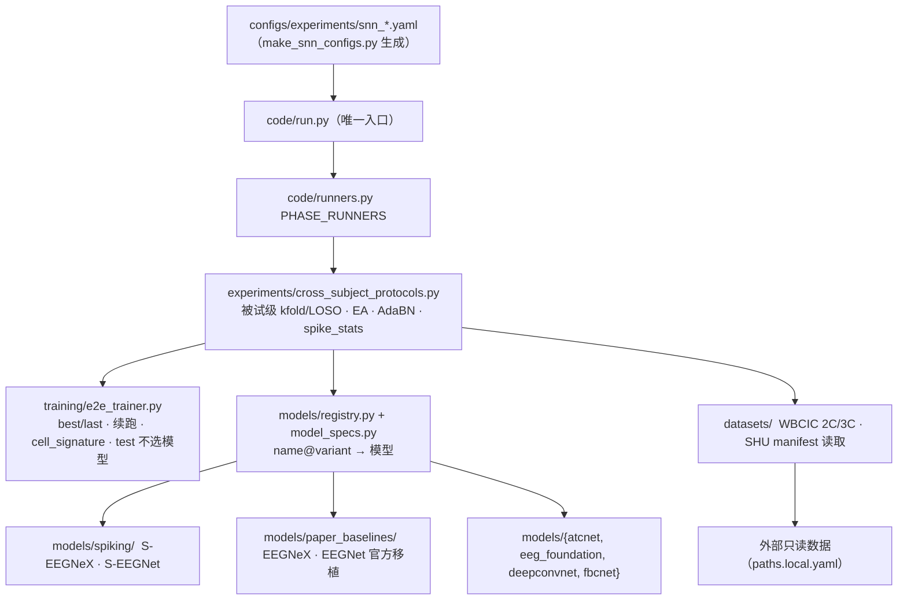

# ARCHITECTURE

> 一份看懂全局。规则在 `AGENTS.md`，状态在 `docs/STATUS.md`。

## 1. 顶层结构（2026-09-18 迁移后）

```text
ICASSP/                                  # = git 仓库根（原 SYX/eeg-mi-online，历史完整）
├── AGENTS.md                            # 唯一灵魂记忆（先读）
├── CLAUDE.md                            # Claude Code 兼容入口 → AGENTS.md
├── README.md                            # 人类快速入口
├── progress.md                          # 逐日流水（最新在上；含 2026-06 起的全部历史）
├── REPRODUCE.md  SETUP.md  LICENSE      # 复现 / 换机 / 许可
├── environment.yml  requirements.txt  pyproject.toml
├── .cursor/rules/*.mdc                  # Cursor 机器可读规则切片（内容与 AGENTS 一致）
├── docs/
│   ├── STATUS.md                        # 现在做到哪、什么在跑、下一步、倒计时
│   ├── PLAN_spiking_eegnex_icassp2027.md# 论文方案 v2（§0 评审采纳表；§0.5 先导结果与主实验决定）
│   ├── PRIOR_RESULTS.md                 # 3 队列 × 18 ANN 的权威摘要（SNN 的配对基线）
│   ├── RESULTS_TRUTH.md                 # WBCIC-SHU 3C 权威表 + 勘误
│   ├── PLAN_cross_subject_benchmark_and_fusion.md   # ANN 基线轮：协议、27 条锁定决定（原文编号 1–27）
│   ├── ANALYSIS_atcnet_and_adversarial.md           # ATCNet 消融 / 域对抗结案分析
│   ├── CROSS_SUBJECT_PROTOCOL_MEMO.md   # 跨被试协议的 7 个问题（发学长拍板用）
│   ├── CROSS_SUBJECT_PROTOCOL_RESEARCH.md   # 协议文献依据全文（原 inbox/，带置信度标签）
│   ├── DECISIONS.md                     # D-001.. 影响口径的决定
│   ├── ARCHITECTURE.md                  # 本文件
│   ├── ICASSP2027_SUBMISSION.md         # 截稿 / 格式 / ORCID / 检查单 / 稿件骨架映射
│   ├── reports/                         # 发给学长的文档（MEETING_BRIEF、REPORT_for_senior，09-18）
│   └── history/                         # 关键会话摘录（09-17~18 方案+先导会话）
├── paper/                               # ICASSP 2027 官方模板 + main.tex + refs.bib + figures/ tables/
├── code/                                # 训练框架（见 §2；2026-09-18 已按 import 闭包剪枝）
├── scripts/                             # 生成配置 / 提交 / 分析 / 预处理（见 §3）
├── tests/                               # pytest（106 项 + 1 skip：models/ 与 foundation/ 两组）
├── outputs/                             # run 产物（gitignore）：experiments/ analysis/ processed/
├── checkpoints/                         # {shu,wbci_shu}/<run_id>/<cell>/{best,last}.pt（gitignore）
├── logs/slurm/                          # 作业日志 + snn_<tag>_job_ids.txt（gitignore）
└── results_snapshot_2026-09-13/         # 只读归档：ANN 基线的 tables/cells/splits（gitignore）
```

`SYX/eeg-mi-online -> ICASSP` 是兼容软链接（主实验作业跑完前不删）。剪掉的遗留在 `SYX/_archive/eeg-mi-online_legacy_2026-09-18/`。

## 2. 代码分层 `code/`



| 路径 | 作用 | 状态 |
|:---|:---|:---|
| `code/run.py` | 唯一人工入口：`--config`、`--models a,b@v`、`--split-seeds`、`--tag-suffix`、`--out/--ckpt-dir`、`--device`、`--folds-subset`、`--max-epochs`、`--no-resume` | **活** |
| `code/runners.py` | `PHASE_RUNNERS`；本轮只用 `run_foundation_cross_subject`（+ `_build_e2e_spec` 等 helper）；传递 `eval.adabn` | **活**。另含 7 个已死的旧 runner（`run_phase0_drift` … `run_cross_session_e2e`，其 lazy import 的模块已归档）——作业结束后删除（STATUS §4） |
| `code/experiments/cross_subject_protocols.py` | 被试级 `kfold_subject` / `loso` / `holdout`，`val_mode` subjects/sessions；归一化语法 `per_sample_zscore` / `ea_session[_mu]+<trial_norm>`（逐 session Euclidean Alignment）；评估时 AdaBN；逐被试 `spike_stats`（发放率 + 能耗）；泄漏断言 | **活（本轮核心）** |
| `code/training/e2e_trainer.py` | 非 CE 损失钩子；每 cell 只存 `best.pt`/`last.pt`；断点续跑（optimizer/scheduler/RNG/history）；`result.json` 完成标记；`cell_signature` v2 守卫；test 不参与选择的守卫；`E2ESpec.adabn` | **活** |
| `code/training/trainer.py` | 旧训练器；本轮只用其 `predict`（`cross_subject_protocols` 与 `session_protocols` 引用） | 在闭包内，作业结束后可瘦身为只保留 `predict` |
| `code/models/spiking/neurons.py` | LIF / PLIF / **HetPLIF**（每通道可学习 τ，逐层对数均匀初值）；ATan 代理梯度；硬/软复位；LI 读出；mask-only `SpikeDropout`；TorchScript 融合循环；无 spikingjelly 依赖 | **活（新）** |
| `code/models/spiking/models.py` | **S-EEGNeX** / **S-EEGNet**（与官方 ANN 相同的权重形状）；`repeat`（T=4）与 `stream`（1000/250/63 步）编码；LI 读出；BN 初始化；编码器位置 `conv1`/`spatial`；逐层 MAC/AC 表 + 实测发放率能耗 | **活（新）** |
| `code/models/spiking/adapter.py` + `registry.py` | 项目契约 `{logits, features, confidence}`；`describe()`；`pop_spike_stats()`；`training_step` = CE + 稳态发放率正则 | **活（新）** |
| `code/models/model_specs.py` | 别名 `name@variant` 的单一参数来源（`defaults` / `per_dataset` / `variants`） | **活** |
| `code/models/paper_baselines/` | EEGNet / EEGNeX / EEG-Deformer / ATCNet **只用作者官方代码**移植（EEGNeX Keras 逐层移植，58,770 参数） | **活** |
| `code/models/external/` | **外部基线轮（D-034，2026-09-19）**：`tcformer` / `labram` / `eegpt` / `cbramod`，每个 `<name>/{_official/（官方代码原样 + LICENSE）, adapter.py, PROVENANCE.md}` + `code/configs/models/<name>.yaml`；`_common.py` = 重采样 / 通道词表 / 权重路径；`__init__.py` 只有静态名单 + `build_external`（registry **懒加载**，不进主实验 import 闭包）；权重在 `weights/`（gitignore；本机软链接到 `../Benchmark/weights/`） | **活（新）** |
| `code/models/atcnet/`, `eeg_foundation/`, `deepconvnet.py`, `fbcnet.py` | 18 条目里的其他 ANN；`eeg_foundation/` = 学长 S4/DINO 包移植 | 活（bench 复现），本轮不跑 |
| `code/models/{eegnet,cap_eegnet}.py`, `atcnet/adapter.py` 的 `ATCNetAdversarial`, `eeg_foundation` 里的 adv / `dualcd_s4_pos` | 弃用模型（`registry.DEPRECATED_MODELS`），`registry.py` 在模块级 import 它们 → 在作业 import 闭包内 | **作业结束后**从 registry 与 yaml 中删除（连带 `tests/foundation` 里引用 `dualcd_s4_pos` 的用例） |
| `code/models/{atcnet/_official_keras, paper_baselines/_official}/*keras*.py` | 作者官方 Keras 源码原件（PyTorch 移植的对照依据，不被 import） | 保留（"只用官方代码"的证据） |
| `code/methods/{session_alignment,bn_adaptation}.py` | **EA（`EuclideanAlignment`）与 AdaBN**——本轮对齐臂的实现 | **活** |
| `code/configs/models/*.yaml` | 每个模型的参数单一来源；`{seegnex,seegnet}.yaml` 变体：`hplif`（D 版）、`s_lif/s_plif/s_hplif`（S 版三种神经元）、单因子消融 `s_hplif_{afe,spk,causal,hard,noinit,noreg,all}` | **活**（5 个弃用模型的 yaml 随 registry 一起在作业后删） |
| `code/configs/experiments/snn_*.yaml` | **24 个** = {shu, wbci2c, wbci3c} × {zs, ea, eamu, eaz} × {lr1e3, lr1e4}；由 `scripts/make_snn_configs.py` 生成，`cross_subject` 块与 bench 逐字相同 | **活**；主实验用 `*_zs_lr1e4` / `*_eaz_lr1e4`（6 个） |
| `code/configs/experiments/{wbci_2c_cross_subject_bench,shu_cross_subject_bench}.yaml` | 18 条目 ANN 基线（已跑完；协议出处；测试读取） | 活 |
| `code/configs/paths.local.yaml`, `datasets/{shu,wbci_shu}.yaml` | 本机外部路径（gitignore）/ 数据集元信息 | **活**；`wbci_3c_processed_manifest` 指向 `outputs/processed/wbci_shu_3c_mat_clean/` |
| `code/datasets/{session_splits,splits,manifest}.py` | manifest 读取、被试分组、划分；`manifest.py` 供预处理脚本写 manifest | 活 |
| `code/preprocessing/{eog_ecg_clean,neuracle_events,shu_mat,wbci_3c_mat}.py` | 数据出处：2C 正式 npz 的清洗函数、SHU / 3C `.mat`→npz | 活（`scripts/preprocess_*.py` 调用） |
| `code/summaries/cross_subject_bench.py` | 配对 Wilcoxon + Holm、Cohen's d_z、Friedman + Nemenyi CD 图、按 val 选变体、跨数据集主表；`analyze_snn_round.py` / `summarize_cross_subject.py` 的后端 | 活 |
| `code/utils/{paths,io,config,logging_utils,seed}.py` | `PROJECT_ROOT = Path(__file__).resolve().parents[2]`（迁移后自动指向 ICASSP）；npz/json IO；配置；日志；种子 | 活 |

**2026-09-18 剪枝（D-031）**：用主实验的真实命令在 CPU 上跑微型 run，记录 `sys.modules` 得到 51 个模块的 import 闭包；闭包之外、且不被保留脚本/测试引用的
`code/{tta,online,legacy,visualization}/`、`code/models/dsgnet/`、`code/methods/t3a.py`、`code/datasets/{base,channel_mapping,registry,shu,shu_dataset,wbci_shu}.py`、
`code/experiments/{session_drift,session_multisource_protocols,session_alignment_protocols,prototype_drift,prototype_drift_summarize,session_tta,cross_session_e2e_protocols}.py`、
`code/summaries/{alignment,canonical,multisource,session,summarize}.py`、`code/preprocessing/{pipeline,shu_preprocess}.py`、`tests/tta/`、
`tests/foundation/test_cross_session_e2e_protocol.py` 与 33 个旧实验 YAML 已移到 `../_archive/eeg-mi-online_legacy_2026-09-18/`。
闭包内的文件（含 `runners.py` 的死函数、registry 里的弃用模型）**在 20 个作业全部结束前不动**。

## 3. `scripts/`

| 文件 | 用途 | 状态 |
|:---|:---|:---|
| `make_snn_configs.py` | 生成全部 `snn_*.yaml`（改网格改这里，不手改 YAML） | **活** |
| `make_baseline_configs.py` | 从 `snn_<ds>_zs_lr1e4.yaml` 生成 `bl_<ds>_zs_lr1e4.yaml`（只改 `models` / `micro_batch_per_model` / `source_config`，`output_dir` 同主实验；`--check` 校验；`tests/models/test_external_integration.py` 断言协议块相同） | **活（新）** |
| `slurm/baseline_gpu.sbatch`, `slurm/submit_baselines.sh`, `slurm/baselines_plan.txt` | 外部基线轮：一卡多进程（`"<config>|<models>|<tag>"` 每个一进程）、`SMOKE_FIRST` 先 1 折 2 epoch 冒烟到 `outputs/experiments/_smoke/`；按计划文件提交、提交前逐 (config, model) `resolve_model_params(dataset=…)` 检查、`--nice=50` 让主实验优先、`N_LINKS` 接力；清单 `logs/slurm/bl_job_ids.txt` | **活（新；不改现有 slurm 文件）** |
| `analyze_snn_round.py` | 预注册配对检验（Wilcoxon + Holm）、H1 差之差、能耗表、过拟合表、Friedman；`--bench` 把 18 个 ANN 作 `+bench` 条目一并配对；输出 `REPORT.md` + 5 张 CSV。**臂名映射**：家族与 H1 写在角色 `zs`/`ea` 上，主实验的 `eaz` 臂必须 `--aligned-arm eaz`（2026-09-18 起映射不上会报错退出，之前会静默漏掉 H1） | **活**（待补 D-014 各项：非劣性 bootstrap、精确/置换 Wilcoxon、HL+BCa、Page's L、5 项家族） |
| `summarize_cross_subject.py` | bench run 的 `tables/`、CD 图、`REPORT_TABLE.md` | 活 |
| `plot_three_curves.py` | 每 cell train/val/test 三曲线 | 活（`curves: true` 时） |
| `preprocess_shu.py`, `preprocess_wbci_3c.py` | SHU / 3C 预处理入口（3C 约 7 分钟） | 活 |
| `slurm/_common.sh` | 项目根自动探测 + conda 激活 + CUDA fail-fast | **活** |
| `slurm/bench_gpu.sbatch` | 单 GPU 作业模板（1 GPU / 8 CPU / 40 G / 47.5 h；`-p` 可覆盖） | **活（主实验在用）** |
| `slurm/submit_snn.sh` | `<config> <tag> "<group>"... [-- extra]`：每组一卡、`N_LINKS` 个 48 h `afterany` 接力；先做 roster 检查；写 `logs/slurm/snn_<tag>_job_ids.txt` | **活** |
| `slurm/submit_bench.sh` | 18 条目 bench 的 4 卡分组提交 | 活 |
| `slurm/shu_gpu.sbatch`, `shu_cpu.sbatch` | 通用 16 h GPU / CPU 模板（短作业、汇总） | 活 |

## 4. 产物约定

- `outputs/experiments/<dataset>/<run_id>/cells/<model>__split<ss>__fold<k>__seed<s>/{result.json, predictions.npz}`（LOSO 与单划分运行无 `split` 段，见 D-030）；`failures__<tag>.json`；`resolved_model_params__<tag>.json`；`splits/`。
- `checkpoints/<dataset>/<run_id>/<cell>/{best.pt,last.pt}`。
- `outputs/analysis/snn_round/<name>/{REPORT.md, per_model.csv, paired_tests.csv, interaction_H1.csv, energy.csv, subject_matrix.csv}`。
- `result.json` 里：`rows[]`（best/last 两套指标 + `adabn_*` 列）、`model_desc`（参数、τ、能耗上界）、`spike_stats`（逐被试发放率）、`train_info`、`fold`（train/val/test 被试）、`cell_signature`、git / 环境指纹。

## 5. 扩展规则

- 加模型：`code/models/<name>/` + `code/configs/models/<name>.yaml` + `registry.py` 注册 + `tests/models/` 测试；学长的 EEGNeX 改版走同一条路，注册即可进同一张表。
- 加实验：改 `scripts/make_snn_configs.py` 的网格再生成；新 `run_id`。
- 加数据集（如 BCI IV 2a）：`code/datasets/<name>.py` + `code/configs/datasets/<name>.yaml`；manifest 走 `paths.local.yaml` 逻辑键。
- 任何新文件不需要再登记 FILE_CATALOG；改了规则改 `AGENTS.md`，改了状态改 `docs/STATUS.md`，做了事记 `progress.md`。
